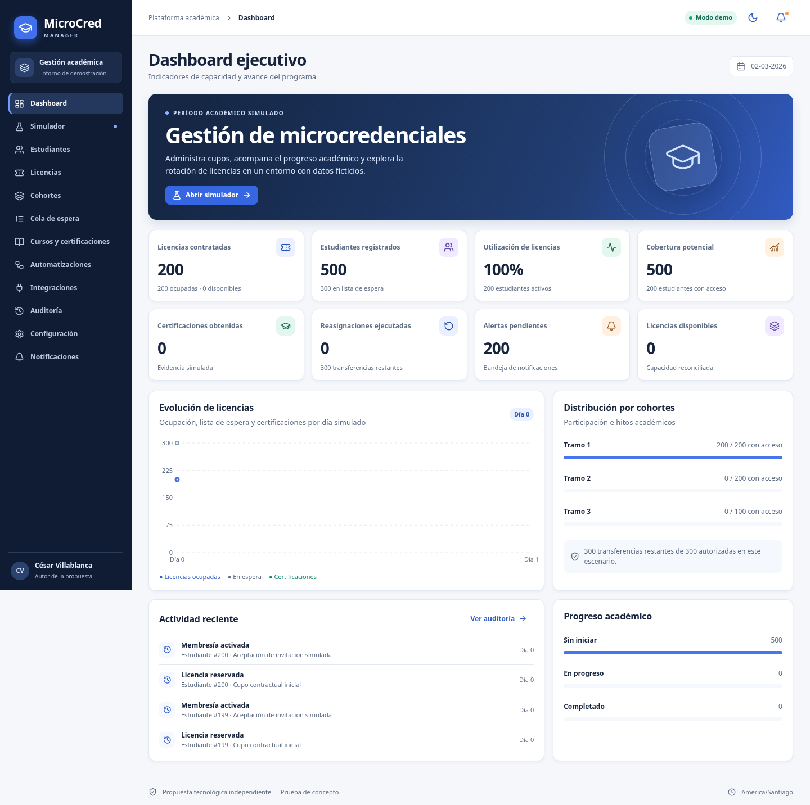
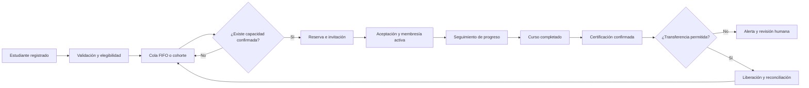
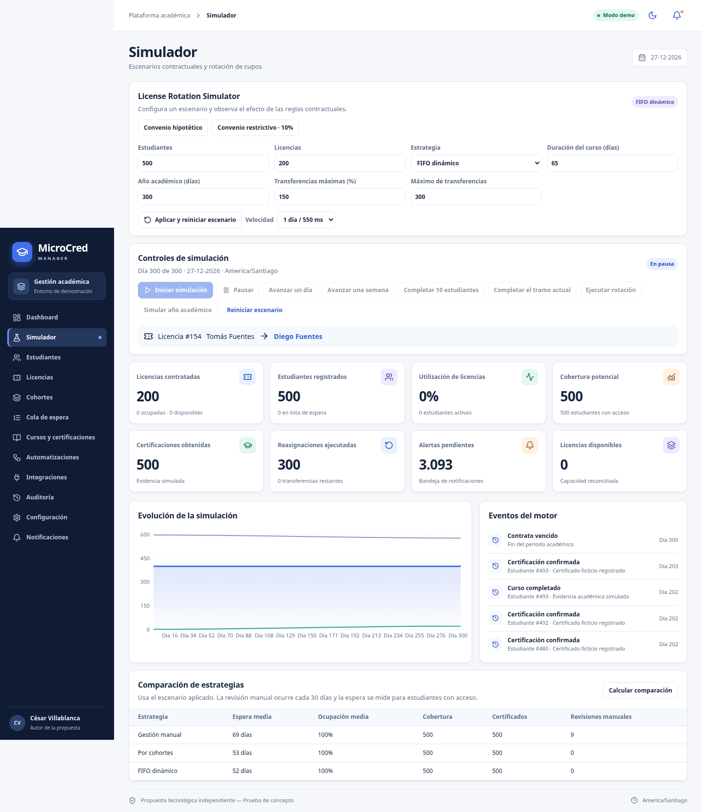
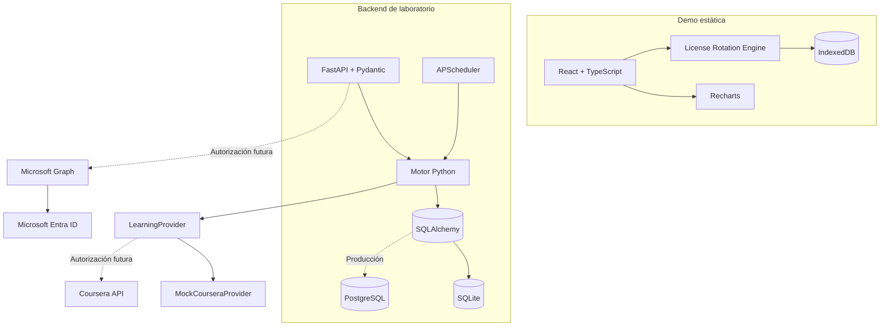

# MicroCred Manager

> **Academic License Management & Automation Platform**
>
> **César Villablanca — Ingeniero en Computación e Informática**

Plataforma de prueba de concepto para administrar, supervisar y automatizar el ciclo de vida de licencias educativas y microcredenciales. El proyecto demuestra cómo una institución puede coordinar **200 licencias para atender a 500 estudiantes durante un año académico**, siempre que el contrato con el proveedor permita las reasignaciones necesarias.

> **Propuesta tecnológica independiente — Prueba de concepto.** No es un producto oficial ni autorizado por la Universidad Andrés Bello. La demostración utiliza únicamente personas, correos, cursos, certificados e integraciones ficticias.



## Contenido

- [Problema que resuelve](#problema-que-resuelve)
- [Cómo funciona la automatización](#cómo-funciona-la-automatización)
- [Funcionalidades](#funcionalidades)
- [Simulador de rotación](#simulador-de-rotación)
- [Modos DEMO y REAL](#modos-demo-y-real)
- [Arquitectura](#arquitectura)
- [Tecnologías](#tecnologías)
- [Ejecución local](#ejecución-local)
- [Pruebas](#pruebas)
- [Seguridad](#seguridad)
- [Documentación](#documentación)
- [Estado del proyecto](#estado-del-proyecto)

## Problema que resuelve

Una institución tiene una cantidad limitada de licencias educativas y una demanda superior a la capacidad disponible. En el escenario inicial existen:

| Recurso | Cantidad |
| --- | ---: |
| Licencias simultáneas | 200 |
| Estudiantes registrados | 500 |
| Primer tramo | 200 |
| Segundo tramo | 200 |
| Tercer tramo | 100 |

Una administración manual debe revisar invitaciones, membresías, avance, finalización, certificados, condiciones contractuales y disponibilidad antes de entregar un cupo a otra persona. MicroCred Manager concentra estas decisiones en un motor determinista, trazable y configurable.

La plataforma busca:

- mantener las licencias ocupadas cuando existen estudiantes elegibles en espera;
- impedir asignaciones duplicadas o superiores a la capacidad contratada;
- separar el inicio de sesión institucional de la asignación de una licencia educativa;
- exigir evidencia de finalización y confirmación de capacidad antes de reasignar;
- bloquear automáticamente operaciones que excedan el contrato;
- registrar cada decisión, cambio de estado, actor y motivo;
- comparar estrategias mediante resultados calculados por el simulador.

## Cómo funciona la automatización



El **License Rotation Engine** implementa dos estrategias.

### Rotación por cohortes

Activa grupos de 200, 200 y 100 estudiantes. El siguiente tramo se abre cuando se cumplen sus fechas, dependencias académicas, evidencia de certificación y reglas contractuales.

### Rotación dinámica FIFO

Mantiene una cola ordenada por prioridad académica justificada, fecha de ingreso e identificador. Cuando se confirma un cupo recuperable, lo asigna al siguiente estudiante elegible.

En ambos casos, una eliminación de membresía no se interpreta automáticamente como una licencia recuperada. El cupo pasa por un estado de reconciliación y solo vuelve al inventario cuando existe confirmación de capacidad.

## Funcionalidades

### Dashboard ejecutivo

- licencias contratadas, ocupadas y disponibles;
- estudiantes registrados, activos y en espera;
- certificaciones y reasignaciones ejecutadas;
- utilización, transferencias restantes y cobertura proyectada;
- evolución temporal, distribución por cohortes y progreso académico;
- actividad y alertas operativas recientes.

### Gestión académica

- generación reproducible de 500 estudiantes ficticios;
- búsqueda, filtros, paginación, detalle e historial individual;
- importación y exportación CSV con deduplicación;
- inventario e historial de las 200 licencias virtuales;
- creación y configuración de cohortes;
- cola de espera con elegibilidad y prioridad justificada;
- catálogo ficticio de IA, Python, datos, ciberseguridad, proyectos, nube y Microsoft 365;
- equivalencias SCT configurables y pendientes de validación académica.

### Automatización y control

- máquina de estados independiente para estudiantes, membresías y licencias;
- reglas automáticas o supervisadas;
- ejecución inmediata y simulación previa en modo dry-run;
- idempotencia, deduplicación y protección contra concurrencia;
- período de gracia y duración máxima de asignación;
- aprobaciones humanas para operaciones sensibles;
- auditoría exportable con identificadores de operación.

### Alertas y notificaciones

Genera avisos por progreso superior al 90 %, curso completado, certificación pendiente o confirmada, licencia recuperable, reasignación, invitación pendiente, inactividad, vencimiento contractual, límite de capacidad y errores de integración. En la demo, todos los correos permanecen en una bandeja local simulada.

### Identity Manager e integraciones

La arquitectura prepara adaptadores para:

- **Microsoft Entra ID**, con sincronización limitada a grupos autorizados;
- **Microsoft Graph**, para identidades y envío futuro de correos;
- **Coursera Business API**, para programas, invitaciones, membresías, inscripciones y reportes;
- futuros proveedores como Microsoft Learn, IBM, Cisco, Oracle y edX.

Las escrituras reales permanecen deshabilitadas hasta contar con credenciales autorizadas, validación contractual y activación explícita de un administrador.

## Simulador de rotación

El módulo **License Rotation Simulator** permite cambiar capacidad, estudiantes, estrategia, duración de cursos, año académico, límite de transferencias, período de gracia y frecuencia de ejecución.



Incluye controles para iniciar, pausar, avanzar un día o una semana, completar estudiantes, cerrar el tramo actual, ejecutar una rotación y simular el año completo.

La demostración incluye dos políticas:

| Escenario | Transferencias | Cobertura máxima calculada |
| --- | ---: | ---: |
| Convenio hipotético habilitado | 300 | 500 estudiantes |
| Convenio restrictivo del 10 % | 20 | 220 estudiantes |

El primer escenario es exclusivamente demostrativo. Los términos generales de Coursera contemplan restricciones de transferencia y el convenio particular de la universidad debe revisarse antes de cualquier operación real.

## Modos DEMO y REAL

### Modo DEMO

Funciona completamente en el navegador, sin backend, credenciales ni servicios pagados. El motor TypeScript guarda el escenario de forma transaccional en IndexedDB. Todas las acciones visibles modifican datos reales de la simulación local.

### Modo REAL

El backend FastAPI proporciona una base de laboratorio con API REST, Swagger, persistencia SQLAlchemy, roles, idempotencia, dry-run y tareas programadas. Usa proveedores simulados por defecto. La conexión institucional requiere completar las condiciones descritas en [Requisitos de producción](docs/PRODUCTION_REQUIREMENTS.md).

## Arquitectura



El código separa interfaz, motor de negocio, conectores y persistencia. Los diagramas de asignación, liberación, FIFO, cohortes, estados, integraciones y entidad-relación están en [Arquitectura](docs/ARCHITECTURE.md).

## Tecnologías

| Capa | Tecnologías |
| --- | --- |
| Frontend | React, TypeScript, Vite, Tailwind CSS, patrón shadcn/ui, Recharts, Lucide |
| Backend | Python, FastAPI, Pydantic, SQLAlchemy, APScheduler |
| Datos | IndexedDB en demo, SQLite en desarrollo, compatibilidad prevista con PostgreSQL |
| Pruebas | Vitest, Playwright, Pytest |
| DevOps | Docker, Docker Compose, GitHub Actions, GitHub Pages |

## Ejecución local

### Demo frontend

Requiere Node.js 22 o superior.

```bash
git clone https://github.com/cesarxbox32/microcredentials-unab.git
cd microcredentials-unab/frontend
npm ci
npm run dev
```

Vite mostrará la dirección local. La demo no solicita autenticación y almacena sus datos en el navegador.

### Backend FastAPI

Requiere Python 3.12 o superior.

```bash
cd microcredentials-unab/backend
python -m venv .venv
source .venv/bin/activate
python -m pip install -r requirements.txt
export MICROCRED_ADMIN_TOKEN="$(python -c 'import secrets; print(secrets.token_urlsafe(32))')"
uvicorn app.main:app --reload
```

Servicios disponibles:

- API en `http://127.0.0.1:8000`;
- Swagger en `http://127.0.0.1:8000/docs`;
- OpenAPI en `http://127.0.0.1:8000/openapi.json`;
- salud en `http://127.0.0.1:8000/health`.

`POST /v1/operations` exige una clave `Idempotency-Key` y funciona en dry-run de manera predeterminada.

### Docker Compose

```bash
cp .env.example .env
# Configura tokens locales aleatorios en .env
docker compose up --build
```

- Demo en `http://127.0.0.1:8080`.
- API y Swagger en `http://127.0.0.1:8000/docs`.

## Pruebas

```bash
cd frontend
npm ci
npm run lint
npm run build
npm test
npx playwright install chromium
npm run test:e2e

cd ../backend
python -m pip install -r requirements.txt
python -m pytest -q
```

Estado verificado del proyecto:

- **10 pruebas Vitest** del motor TypeScript;
- **5 pruebas Pytest** del backend y conectores;
- **3 recorridos Playwright** sobre la compilación de producción;
- verificación de ESLint, TypeScript y Vite;
- construcción y arranque comprobados con Docker Compose;
- prueba de escala con 5.000 estudiantes y 1.000 licencias.

Los resultados exactos y sus limitaciones están en [Resultados de pruebas](docs/TEST_RESULTS.md).

## Seguridad

- modo real deshabilitado por defecto;
- secretos únicamente mediante variables de entorno;
- roles de administrador, operador y auditor en la API de laboratorio;
- validación de entradas y dominio ficticio `.example`;
- exportación CSV protegida contra fórmulas;
- tokens distintos por rol;
- operaciones simuladas por defecto;
- reconciliación obligatoria antes de reutilizar capacidad;
- exclusión de secretos, bases de datos y claves privadas mediante `.gitignore`.

Consulta [Seguridad](docs/SECURITY.md) para conocer el alcance y las medidas requeridas antes de producción.

## Despliegue

El workflow [CI y GitHub Pages](.github/workflows/ci-pages.yml) instala dependencias, ejecuta lint y pruebas, compila el frontend y publica `frontend/dist` en GitHub Pages.

La ruta esperada de la demo es:

`https://cesarxbox32.github.io/microcredentials-unab/`

La disponibilidad pública depende de que GitHub Pages esté habilitado y de que el plan admita Pages para el repositorio privado. Revisa el procedimiento completo en [Despliegue](docs/DEPLOYMENT.md).

## Documentación

| Documento | Contenido |
| --- | --- |
| [Arquitectura](docs/ARCHITECTURE.md) | Componentes, flujos, estados y modelo de datos |
| [Modelo de negocio](docs/BUSINESS_MODEL.md) | Políticas, cobertura y estrategias |
| [Integración Coursera](docs/COURSERA_INTEGRATION.md) | Endpoints verificados, límites y requisitos |
| [Microsoft Entra ID](docs/MICROSOFT_ENTRA_INTEGRATION.md) | Identidad, Graph, permisos y SSO |
| [Seguridad](docs/SECURITY.md) | Controles implementados y pendientes |
| [Despliegue](docs/DEPLOYMENT.md) | GitHub Pages, Docker y operación futura |
| [Manual de usuario](docs/USER_MANUAL.md) | Recorrido funcional de la plataforma |
| [Propuesta ejecutiva](docs/EXECUTIVE_PROPOSAL.md) | Valor, riesgos y plan institucional |
| [Resultados de pruebas](docs/TEST_RESULTS.md) | Evidencia de verificación ejecutada |
| [Requisitos de producción](docs/PRODUCTION_REQUIREMENTS.md) | Condiciones para una implementación real |
| [Informe final](FINAL_REPORT.md) | Funciones reales, simuladas y pendientes |

## Estado del proyecto

La prueba de concepto está funcional y verificada localmente. La demo opera sin credenciales, el backend expone una base segura de laboratorio y la documentación distingue explícitamente lo simulado de lo que requiere autorización institucional.

Antes de producción se debe validar el contrato particular, habilitar accesos oficiales de Coursera y Microsoft, migrar a PostgreSQL, implementar procesamiento durable de trabajos externos y completar las revisiones institucionales de seguridad, privacidad y gobierno académico.

---

Desarrollado por **César Villablanca — Ingeniero en Computación e Informática**.
