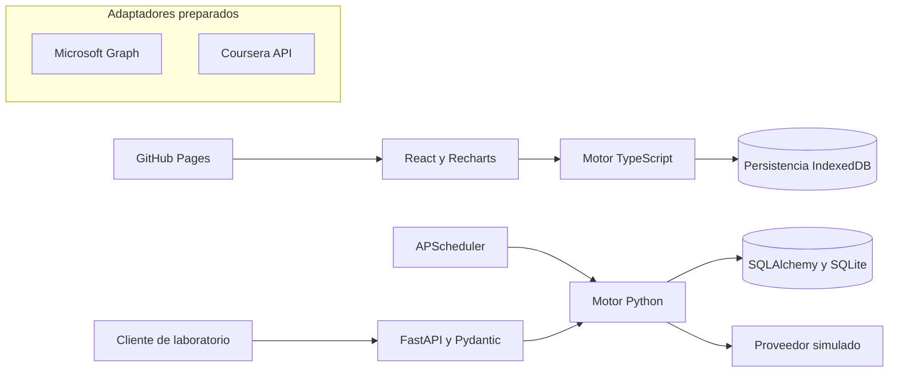
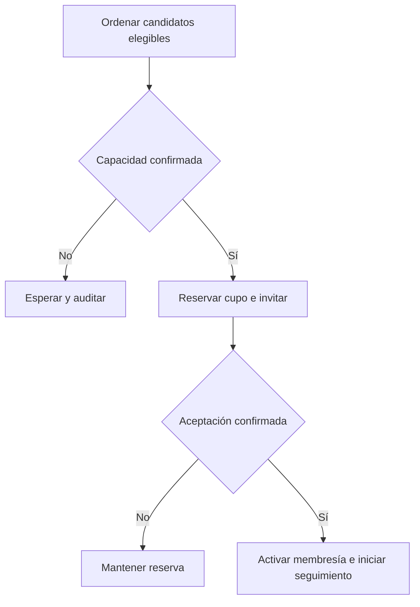
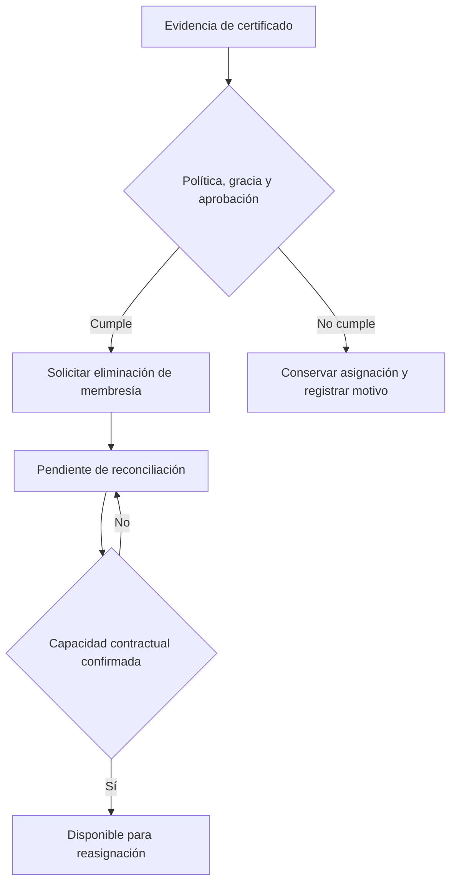
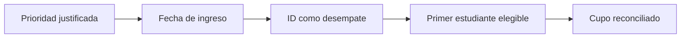
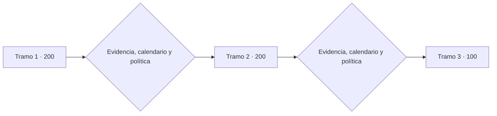
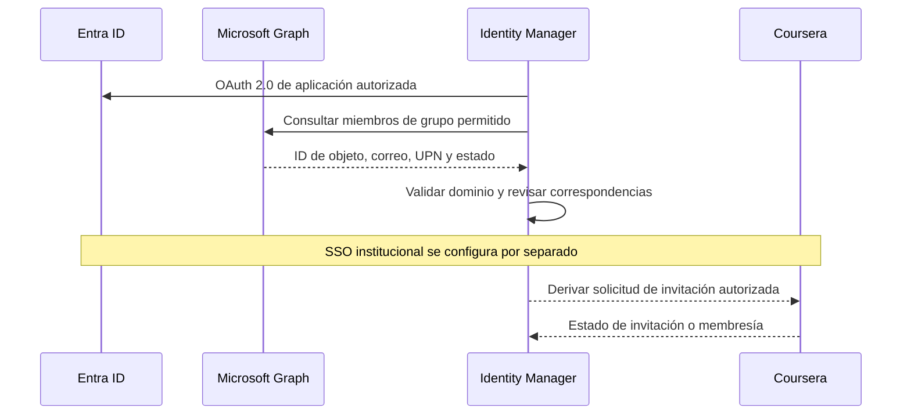
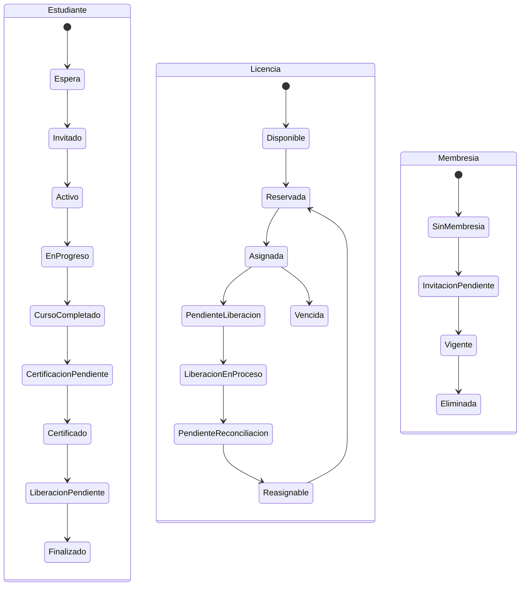
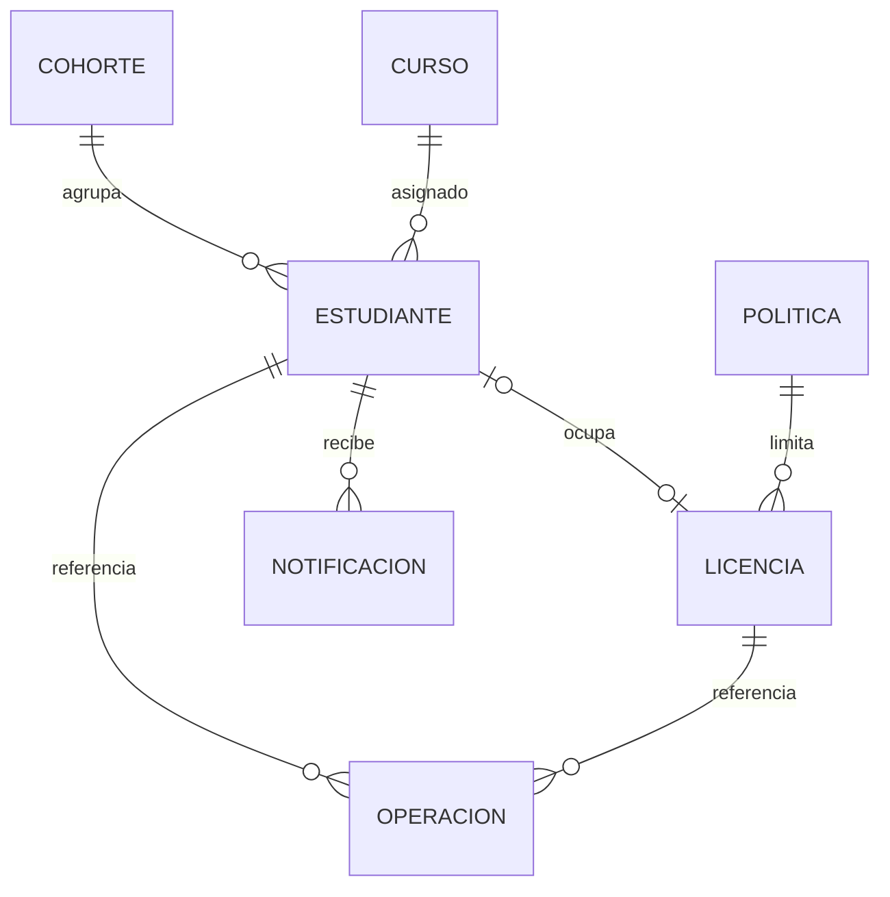

# Arquitectura

El navegador ejecuta el motor TypeScript y almacena escenarios ficticios localmente. El backend de laboratorio expone un motor Python por REST, persistencia independiente y una frontera de integración. La regla de negocio evita asignar a una persona dos cupos o entregar un cupo sin evidencia de capacidad disponible.

## Asignación

## Liberación y reconciliación

## Rotación FIFO y cohortes

## Entra ID y Coursera

## Estados

## Modelo entidad-relación

En SQLite se persisten política, estudiantes, licencias y operaciones. Las referencias de auditoría se registran en JSON por transición. Cohortes configurables, cursos y notificaciones residen en el motor del navegador. El acceso al backend se serializa mediante actualización de la fila de política. Para operación institucional se requiere un modelo con contratos y proveedores independientes, historial de asignaciones, restricciones de base de datos y un trabajador durable. [Requisitos de producción](PRODUCTION_REQUIREMENTS.md)
