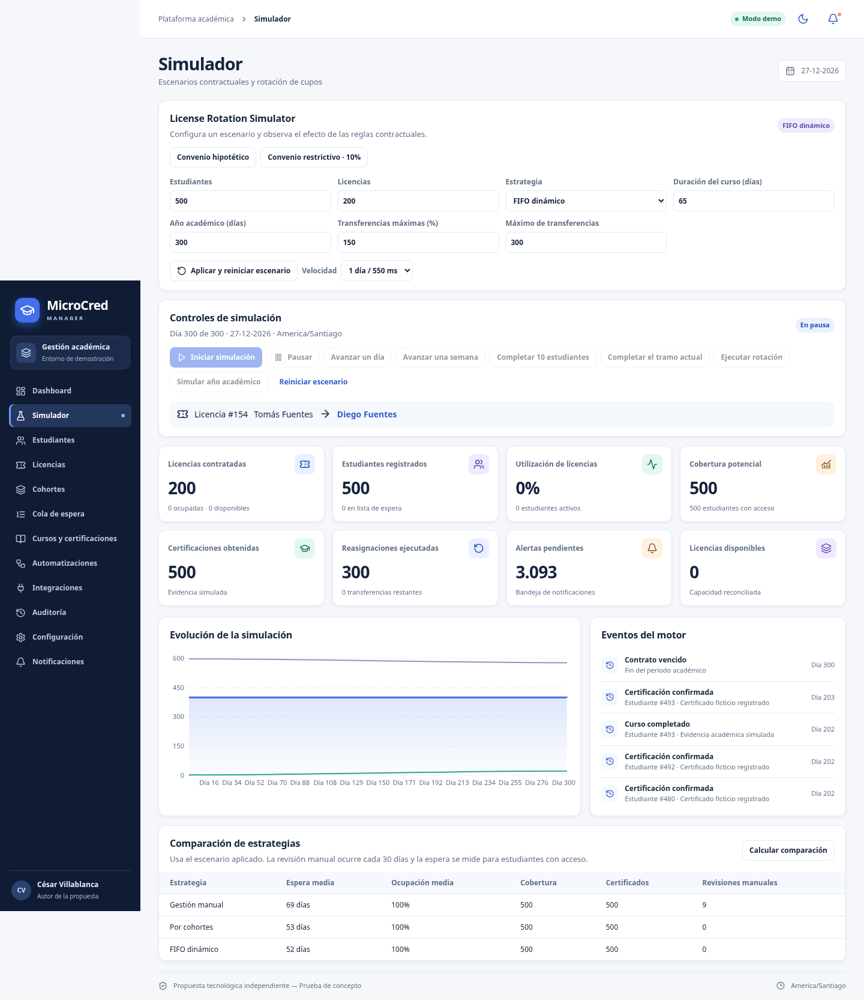

# Manual de usuario

## Demostración en cinco minutos

1. Abre el dashboard. Comprueba 200 cupos ocupados, 500 estudiantes y 300 en espera.
2. En **Simulador**, selecciona **Convenio hipotético** y aplica el escenario. Elige FIFO dinámico o Por cohortes.
3. Completa diez estudiantes y avanza un día. En FIFO aparece la transferencia de una licencia recuperada. En cohortes, completa el tramo y avanza un día para abrir el siguiente.
4. Ejecuta **Simular año académico**. Comprueba 500 estudiantes con acceso y 300 reasignaciones en el escenario predeterminado.
5. Aplica **Convenio restrictivo · 10%** y repite. Comprueba 220 estudiantes con acceso, 20 transferencias y la alerta contractual.
6. Usa **Calcular comparación** para comparar espera media, ocupación, cobertura, certificaciones y revisiones manuales. Los resultados se generan desde cero con la configuración aplicada.

## Operación diaria simulada

- **Estudiantes** permite buscar, filtrar, seleccionar, exportar y consultar detalle. Para importar usa UTF-8 y encabezados `nombre,correo`. El correo debe pertenecer al dominio ficticio configurado. Las filas duplicadas o inválidas se omiten y se auditan los totales.
- **Licencias** muestra inventario, fecha aproximada e historial por cupo.
- **Cohortes** permite definir fechas, cupos, dependencia y activación. Para mover participantes en espera, escribe sus IDs separados por comas.
- **Cola de espera** admite prioridad académica con justificación. Un valor más alto se atiende primero entre candidatos elegibles.
- **Cursos y certificaciones** muestra el catálogo y equivalencias SCT de referencia. La aprobación académica corresponde a la institución.
- **Automatizaciones** cambia frecuencia, ejecución automática y modo supervisado. **Simular operaciones** usa una copia y **Aprobar rotación** solicita confirmación.
- **Integraciones** registra una sincronización simulada y una prueba de correo ficticia. **Notificaciones** muestra ambos eventos operativos y la bandeja cuando corresponde.
- **Auditoría** permite revisar y exportar transiciones. **Configuración** recrea el escenario al aplicar parámetros. Exporta el material que quieras conservar antes de reiniciar.

Para probar invitaciones, desactiva la autoaceptación en Configuración. Abre el detalle de un estudiante invitado y acepta manualmente. Los cupos reservados cuentan en utilización. La cobertura aumenta cuando se activa la membresía.
